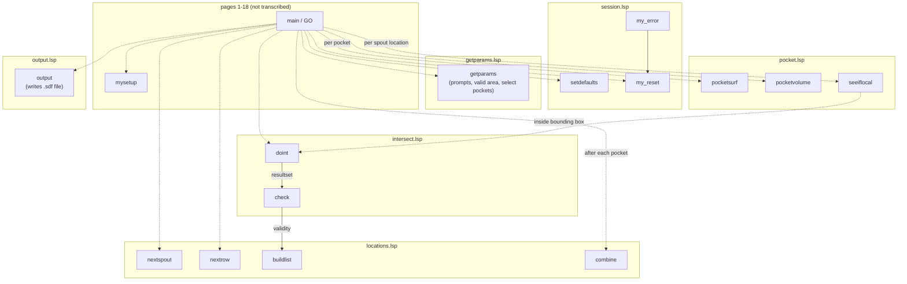
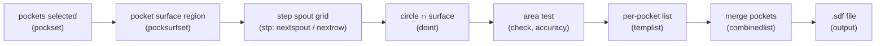

Boxes are grouped by file in `src/`. The `GO` entry point (`main`) is on the
missing pages 1-18, so its calls (dashed arrows) are inferred from the variable
listing and the function comments; solid arrows are calls visible in the code.

## Data flow

