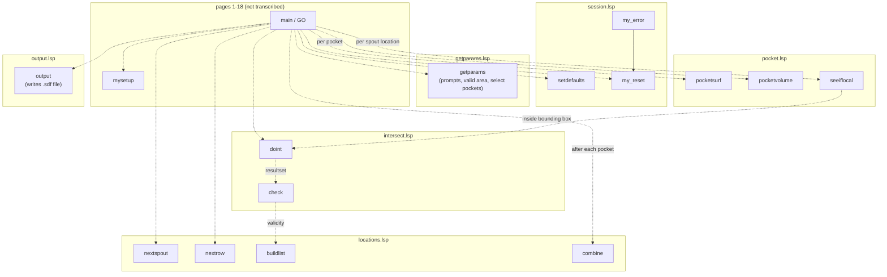
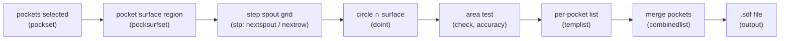

SpoutFinder answers one question over and over: **does a spout of this
diameter fit at this position inside this pocket?** Everything else in the
program exists to ask that question quickly, hundreds of times, on a machine
that could barely hold the answers. The pages below were read from the
original listing, so everything here is traceable to a line of AutoLISP.

## The test: does a circle fit?

The program works on solid models. For each pocket it takes a horizontal slice
(`solsect`), giving a flat region called the pocket surface. At every candidate
position it draws a circle the size of a spout, turns it into a region
(`solidify`), and intersects the two (`solint`). It then compares areas.



The tolerance is a parameter the user types in (default 2%), so a spout that
only just pokes over a ragged pocket edge can still be accepted if the
operator allows it.

## Walking the grid

Positions come from a point `stp` that starts at (0, 0). `nextspout` moves it
along the row by the spout pitch. `nextrow` resets it and steps over by the
increment distance. The count of spouts and increments fixes the size of the
whole grid, so every pocket produces a list of exactly the same length.



## The call graph

Boxes are grouped by file in `src/`. The `GO` entry point (`main`) is on the
missing pages 1 to 18, so its calls (dashed arrows) are inferred from the
variable listing and the function comments. The only call visible in the
transcribed code is the solid arrow from `my_error` to `my_reset`.



## The data flow



## What the output file holds

`buildlist` records one entry per grid position: the pocket's entity name where
a spout fits, and `0` where it does not. `combine` then merges the lists from
all pockets, keeping a pocket's entity name wherever any pocket claimed that
position. A comment in the listing says the entity name is meant to be replaced
by a time value once the volume has been worked out.

`output` writes the result as a plain text file: a header line, then one line
per increment with one space-separated entry per spout. The shape, using
made-up values for illustration, is:

```text
SpoutFinder V0.1 beta DATA FILE

0 0 <entity> <entity> 0 0 0 0
0 <entity> <entity> <entity> <entity> 0 0 0
0 <entity> <entity> <entity> <entity> 0 0 0

End of File
```

## Working inside the limits

Much of the code is not about spouts at all. It is about not running out of
memory, time or patience. These are the tricks visible in the listing.

| Problem | What the code does | Where |
| --- | --- | --- |
| AutoLISP could run out of selection sets | Sets `cellset` and `cellnameset` to `nil` after use so the slots are freed | `doint`, `intersect.lsp` |
| Erased solids still bloat the drawing | Counts cycles and calls `solpurge` every `purgeflag` cycles to clear them out | `check`, `intersect.lsp` |
| An intersection that finds nothing leaves clutter | Erases the last two entities (the circle and the copied surface) straight away | `check`, `intersect.lsp` |
| Solid operations are slow | A bounding-box test, `seeiflocal`, is provided to rule out far-away positions cheaply | `seeiflocal`, `pocket.lsp` |
| A crash would leave AutoCAD changed | `my_error` replaces AutoCAD's error handler, and `my_reset` restores osnap, command echo and blips, and ends the undo group | `session.lsp` |
| The user needs to see it is alive | Prints a `.` for every spout written, on a cleared text screen | `output`, `output.lsp` |

## Where to read the code

Each box in the call graph is a file under [Source](../source/): the prompts in
[getparams.lsp](../source/getparams/), the geometry in
[pocket.lsp](../source/pocket/), the test in
[intersect.lsp](../source/intersect/), the grid in
[locations.lsp](../source/locations/), the housekeeping in
[session.lsp](../source/session/) and the file writer in
[output.lsp](../source/output/). Every variable is described in the
[variable listing](../source/variable-listing/).
