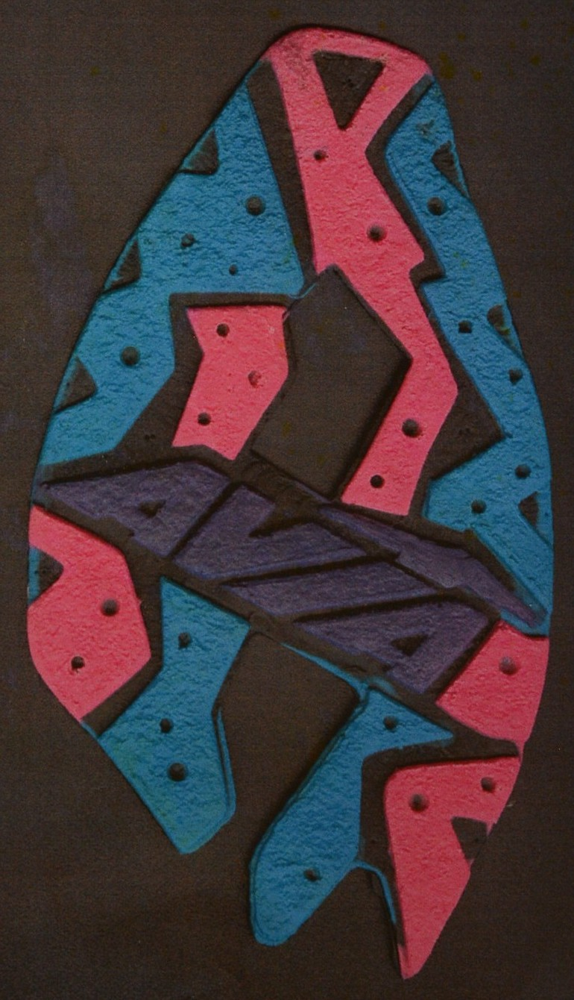
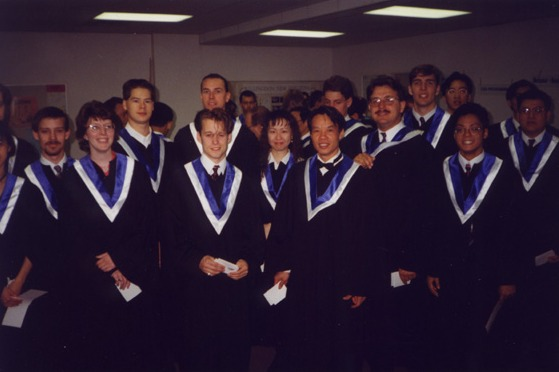
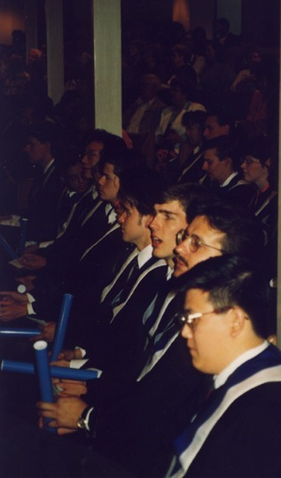
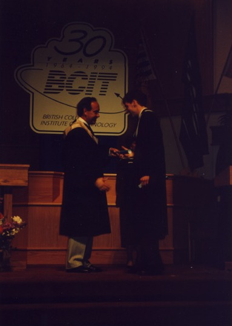
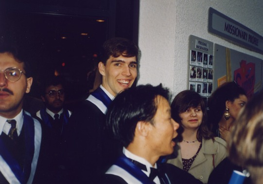
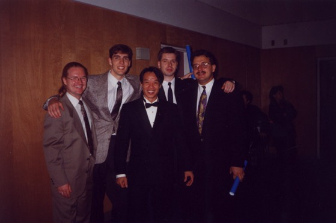

Photographs from the end of the project: one of the prototypes it was meant to
produce, and the graduation that followed.

## A prototype sole

A prototype sole of the kind the project was built to serve. Each color
region is a separate pocket, which is why the machine needed to know where to
place a spout in every one. The photo is cropped from a photograph of a
printed photograph, so the plastic is all that remains in frame.

## Graduation, June 1994

The Mechanical CAD/CAM option of the Diploma of Technology at the British
Columbia Institute of Technology (BCIT), which this project completed.

